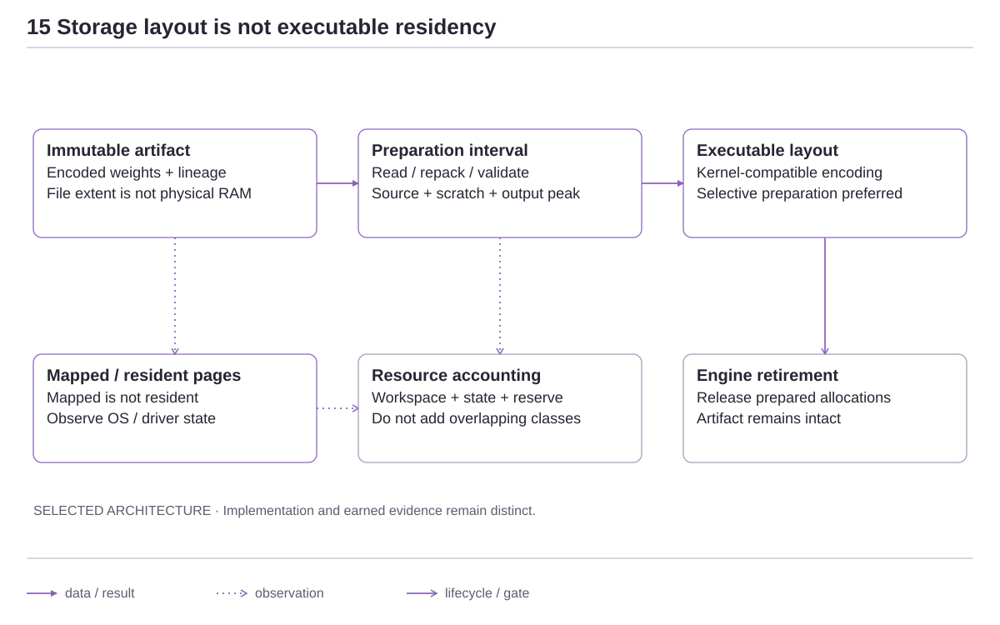

<!-- docs:metadata
title: Representation, Quantization and Artifacts
id: yvex.architecture.representation-artifacts
document: architecture-plane
status: mixed
owner: compiler
audience: [engineer, agent, evaluator]
publication: {html: true, pdf: true, index: true}
plane: representation-artifacts
related: [yvex.architecture.artifacts-admission, yvex.architecture.deployment-specialization]
-->

# Representation, Quantization and Artifacts

**A logical model can have several exact physical representations.**

[Up](README.md)

Quantization changes how values are represented. It does not redefine the
model's logical role graph. GGUF is an admitted physical container, not the
identity of the logical model.

## From policy to bytes

Source roles and numerical constraints → physical policy/quant plan → encoded
tensor layout → deterministic artifact writer → admission.

| Choice | Boundary |
| --- | --- |
| Tensor qtype, packing, layout and scale companions | Physical representation and artifact identity |
| Exact source-derived operation/numerical meaning | Model semantics and compiler |
| Admitted implementation class and machine budget | Deployment specialization |
| Equivalent warp, tile and stream mechanics | Backend |

Calibration and importance matrices must retain their source identity. A prior
from a different checkpoint is a prior, not calibration of the new checkpoint.

The native importance-matrix owner also provides a bounded, population-aware
activation accumulator through `quant.h`. It computes sufficient statistics
from explicitly supplied real rows; its [numerical and atomicity contract](../contracts/numerical-abi.md#offline-activation-sufficient-statistics)
does not capture model execution or authenticate a calibration producer.
An experimental capture must separately bind the checkpoint, actual bootstrap
representation/numerics, compiled operands, corpus, execution and completeness.
Statistics observed through an existing quantized realization are not silently
relabelled as unquantized-source activations. Complete expert coverage alone
does not establish representative calibration or independent held-out quality.
Producing an authenticated importance matrix and admitting its use in a new
physical recipe remain distinct from this arithmetic primitive.

The numeric-profile entrypoint checks the required source identity for both a
bound v2 manifest and explicitly declared legacy raw-DAT provenance. Raw data
does not acquire authority to identify a different checkpoint by being supplied
through a compatibility path; matching declarations still do not prove collection
history or quality.

### Explicit IQ2 encoding producer

Policy v1/v2 preserve the original IQ2 encoder and their exact identities.
Policy v3 requires `iq2_encoder`: `legacy-grid-v1` or `weighted-grid-v2`.
The latter searches a deterministic 16-neighbor magnitude codebook with seven
scale seeds, three bounded least-squares refinements and three final FP16 scale
candidates. Fitting uses the actual decoded levels (8, 25, 43), not the proxy
levels (1, 3, 5). Each published block retains the lower calibration-weighted
reconstruction loss between the new search and the original encoding.

The policy identity, quant decision's numeric producer version and payload
recipe bind this choice. Version 2 applies only to explicitly selected IQ2
decisions; scalar/Q2/MXFP4 encoders and existing bindings do not change.
The complete writer additionally records `yvex.quant.iq2_encoder_contract` for
version 2. The 66-byte IQ2 storage ABI and runtime decoder remain unchanged.
This is a representation producer, not a new inference arithmetic class or an
independent model-quality certificate. Re-emission needs its own artifact and
binding; existing artifact consumers are not automatically changed.

The native policy owner can derive an admitted IQ2 producer from a sealed policy
without editing its selectors or encoded qtypes. A no-op preserves the exact
identity; a producer change normalizes the policy and rule schema tags to v3
before hashing, so canonical JSON publication/readback has the same identity.
The original policy is never mutated. Unknown producers and policies without IQ2
rules refuse. This constructor feeds compiler reconstruction alternatives; it
does not supply missing calibration or transfer quality between producers.

The producer's process-shared immutable neighbor table occupies 699,056 bytes,
in addition to the existing 43,691-byte legacy table. Initialization occurs once;
search scratch is bounded per worker and does not create a second weight matrix.
This offline process storage is distinct from engine-local prepared weights.

### Source-bound numeric calibration

The existing `--imatrix-manifest` input accepts raw DAT with the family's
explicit legacy provenance, or `yvex.imatrix_manifest.v2`. The latter binds
the exact source payload identity, calibration dataset identity, producing
execution-context identity, numeric-file SHA-256 and producer/version. The
compiler checks the source against the sealed Transformation IR, then the
importance-matrix owner checks the declared bytes and mapping budget before
publishing data. A legacy metadata manifest is not numeric calibration.

The context is a semantic projection: source/representation, admitted
arithmetic, workload content and real observed populations. Local paths,
timestamps and live engine generations do not identify it. Paths only locate
the manifest and DAT; relative paths retain the CLI working-directory meaning.
The opaque data identity binds this context in addition to the existing numeric
and producer facts. Existing raw-data identities remain unchanged.

Coverage claims in a manifest are descriptive. Quant execution independently
requires an actual numeric entry covering each selected terminal's complete
expert-row geometry. Missing populations cannot be filled with invented means.
Bootstrap statistics from a quantized engine remain distinct from independent
checkpoint calibration and held-out quality. Neither this manifest nor a
successful plan grants model-quality qualification or deployment authority.
Execution borrows a stable numeric snapshot for its entire call. It revalidates
any supplied calibration owner before terminal commit and final completion;
drift refuses rather than publishing a completed encoding under a stale identity.

## Current machinery and target search

Current quant planning, encoding, writer and admission machinery can construct
selected representations. The [bounded native search](compiler-ir.md#goal-constrained-physical-search-partial-implementation)
now synthesizes policies and checks initial constraints before expensive emission.
Automatic sensitivity search, Pareto selection, prepared execution layouts and
qualified hardware-aware recommendation remain unearned exits of the selected
[Physical Model Compiler target](../research/physical-model-compiler.md).

## Physical policy

### Scalar outer-axis aggregation

The parameter compiler executes the existing Transformation IR `STACK` for
homogeneous direct BF16/F16/F32 sources on axis zero. Container lowering
distinguishes the inserted population axis from each source axis; routed-expert
contributions must retain their exact expert ordinals. Other axes and computed
operands refuse before byte execution.

The executor streams one operand at a time through the existing terminal
transaction. Exact scalar storage preserves source bits, checks finite values,
and does not allocate a stacked weight copy. Cancellation or invalid data in a
later operand aborts the entire terminal; staged bytes are not a published tensor.
Scalar output encodings are admitted; block-quantized `STACK` consumers are not.
This is a generic parameter-production mechanism, not a complete Liquid model
recipe, runtime binding or inference qualification.

`unit.quant_execute` covers canonical lowering/profile planning, byte-exact
ordered BF16 output, cancellation/reuse, inner-axis refusal and nonfinite
second-operand refusal with source lineage. Existing IDENTITY, scale-paired,
checked-cast and MXFP4 expert controls remain independent regressions.

### Terminal representation decisions

A physical variant resolves physical class, storage qtype, tensor and row
geometry, encoded size, approximation/calibration obligations, policy identity,
and backend-compute availability for every terminal tensor. The requested
backend currently filters candidate feasibility; it does not turn the variant
into a device-specific deployment optimization. Quantization codecs and qtype
geometry are canonical owners, while selection of a qtype for one tensor is a
parameter-representation decision.

Writer and runtime owners consume the resolved variant. They do not pick a
different representation for convenience.

The physical variant owns canonical encoded representation. Physical Execution
IR schema v5 is the package projection for each terminal tensor: canonical role,
scope, coordinates, qtype, row geometry, encoded range, alignment, consumer,
stable layout, sharing, and terminal identity. It deliberately contains no
backend, device, activation, kernel-family, width-crossover, evidence, fallback,
or live-resource policy.

At model-engine open, the runtime combines these authenticated package decisions
with one real backend/device and seals an engine specialization. That
specialization owns the admitted implementation class, activation
representation, legal real widths, fallback-equivalence class, and any
hardware crossover. Actual compatible rows and routed populations still belong
to executable batches and expert worklists. CUDA may select an equivalent
microkernel inside the admitted class, but it cannot infer semantic
compatibility, manufacture width, or select a numerically different class.

Package identities therefore change with model/storage meaning. Specialization
identity changes with deployment-significant implementation facts. Equivalent
warp, tile, grid, stream, and launch geometry stays backend-local and does not
rebuild the package or binding.

## Executable weight preparation boundary

Storage encoding, executable layout and residency are independent decisions.
Registering or warming a GGUF mapping does not repack its quantized blocks for
a matrix kernel. Conversely, an aligned/plane-separated representation may be
prepared without changing decoded values; it still needs a compatible admitted
consumer, explicit storage and a lifetime. Preparation is not automatically a
speedup and a numerically different consumer is not an equivalent layout change.

For the selected computational reconstruction, the next admissible design is
**selective or replacement preparation**, not an unconditional second complete
resident weight copy. This is a design constraint, not an implemented new mode.
The compiler must describe legal parameter geometry and numerical obligations;
deployment must select and identity-bind the compatible executable realization;
the backend constructs/executes its buffers within engine-owned lifetime.
Do not put device pointers, current free memory or live kernel policy into
package PEIR v5. A persisted transformed package needs its own physical identity;
an engine-local compatible layout belongs to the sealed specialization and its
resource report, not a second semantic model.

Before admitting such a realization, retain the source terminal/representation,
layout/version, numerical class, consumer geometry, alignment and legal widths;
construction scratch and time; retained prepared bytes; overlap with source
backing during construction; and release/refusal behavior. Replaced spans must
not retain a compulsory resident duplicate. File-backed pages remaining in cache
are not automatically such a duplicate, nor are they automatically reclaimable
under a particular registration. Account for the actual backing and driver path.
Publication follows completed preparation and validation; partial construction
must unwind without invalidating the authenticated artifact or another engine.

The pre-Program-P matrix-triplet selector required IQ2_XXS gate/up and Q2_K down,
so the native 0731 Q2_K triplet was incompatible even when its storage codec was
readable. Program P extends that generic consumer to homogeneous Q2_K gate/up
pairs under the existing encoded arithmetic class; row/matrix numerical and
CUDA memory controls are distinct from complete-model qualification. The
extension does not prepare a second weight copy or promote model quality.
Changing storage to calibrated IQ2 remains a separate physical variant with
checkpoint-matched calibration and quality obligations. See the
[dated admission boundary](../evaluation/retained-observations.md#0731-memory-audit-and-operator-reboot-boundary-2026-10-10).

<!-- docs:diagram optimization_layout_lifetime -->

[Full-size diagram](../assets/diagrams/optimization_layout_lifetime.svg) · [Editable source](../assets/diagrams/optimization_layout_lifetime.json)
<!-- /docs:diagram -->

The profile-driven compiler searches these boundaries through
[explicit technique contracts](compiler-ir.md#technique-composition-and-bounded-allocation).
An allocation estimate, a file mapping, an addressable CUDA span and observed
resident physical pages are different quantities. Candidate reports must not
add them as independent copies. A derived layout's temporary construction peak
is charged even if its source backing can later be released or reclaimed.

## Implementation and evidence

[src/gguf](../../src/gguf) · [src/model/compilation](../../src/model/compilation) · [include/yvex/qtype.h](../../include/yvex/qtype.h) · [include/yvex/quant.h](../../include/yvex/quant.h)

[QA selection](../evaluation/qa.md) · [Current state](../project-control/STATUS.md)

## Continue

[Artifact and Package Admission](artifacts-admission.md) · [Deployment and Specialization](deployment-specialization.md)
