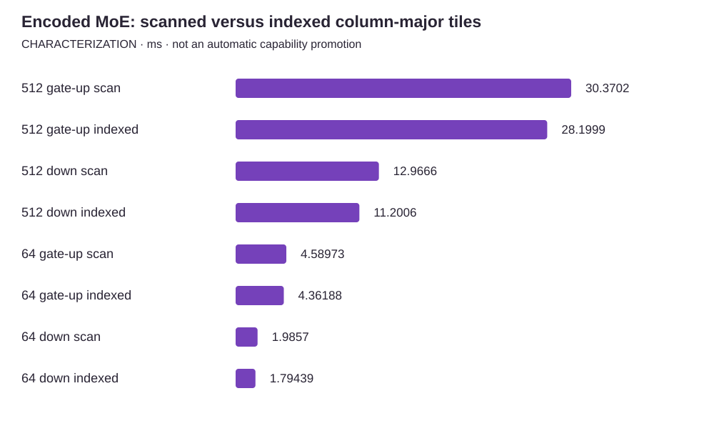

<!-- docs:metadata
title: 'Encoded MoE: scanned versus indexed column-major tiles'
id: yvex.evaluation.observation.cuda-moe-indexed-tiles-20261011
document: evaluation
status: current
owner: evaluation
audience: [engineer, evaluator, agent]
publication: {html: true, pdf: true, index: true}
generated: true
source: ../data/cuda-moe-indexed-tiles-20261011.json
-->

# Encoded MoE: scanned versus indexed column-major tiles

**CHARACTERIZATION — one structured observation, with its original limits.**

[Benchmarks](../README.md) · [Source observation](../data/cuda-moe-indexed-tiles-20261011.json)

| Measurement | Value | Unit | Samples | Scope |
| --- | ---: | --- | ---: | --- |
| 512 gate-up scan | 30.3702145 | ms | 11 | CUDA events, builder plus one gate-up projection; 3072 real selected pairs, 256 experts; 16 iterations/sample; min 30.0496368, max 30.9907322, MAD 0.11443900000000085; not full-model latency |
| 512 gate-up indexed | 28.1998501 | ms | 11 | CUDA events, builder plus one gate-up projection; 3072 real selected pairs, 256 experts; 16 iterations/sample; min 28.1108532, max 29.0457115, MAD 0.07416539999999827; not full-model latency |
| 512 down scan | 12.9665604 | ms | 11 | CUDA events, builder plus one down projection; 3072 real selected pairs, 256 experts; 16 iterations/sample; min 12.9036522, max 13.6300402, MAD 0.05250460000000068; not full-model latency |
| 512 down indexed | 11.2005558 | ms | 11 | CUDA events, builder plus one down projection; 3072 real selected pairs, 256 experts; 16 iterations/sample; min 11.0959282, max 11.8329964, MAD 0.06437209999999993; not full-model latency |
| 64 gate-up scan | 4.58973408 | ms | 11 | CUDA events, builder plus one gate-up projection; 384 real selected pairs, 65 experts; 16 iterations/sample; min 4.56028986, max 4.81532192, MAD 0.011194230000000083; not full-model latency |
| 64 gate-up indexed | 4.36188412 | ms | 11 | CUDA events, builder plus one gate-up projection; 384 real selected pairs, 65 experts; 16 iterations/sample; min 4.33247995, max 4.8712101, MAD 0.024191850000000237; not full-model latency |
| 64 down scan | 1.98570204 | ms | 11 | CUDA events, builder plus one down projection; 384 real selected pairs, 65 experts; 16 iterations/sample; min 1.93488801, max 2.25571799, MAD 0.036010019999999976; not full-model latency |
| 64 down indexed | 1.79439402 | ms | 11 | CUDA events, builder plus one down projection; 384 real selected pairs, 65 experts; 16 iterations/sample; min 1.74072194, max 2.21388412, MAD 0.04927205999999984; not full-model latency |

## Context

Model: **Synthetic encoded MoE component, not DeepSeek inference**. Backend: **cuda**. Device: **NVIDIA GB10; one device, coherent unified-memory domain; driver 580.159.03; CUDA toolkit 13.0.88; sm_121**.
Source commit: `683ee8406a764335ff0c7dd112e557be25b8f4de`. Source stability: **frozen**. Warm/cold: **warm**.

Evidence pointer: /home/dgmothx/lab/models/evidence/program-p-tile-dispatch-20261011.xw7JkaVr/component-final.jsonl; reproduction source dispatch_bench.c; frozen patch tile-column-candidate.patch; build hashes tile-column-build.sha256

## Limits

- Component characterization only: no DeepSeek checkpoint, artifact, binding, TTFT, committed decode or 2K/8K result is measured by this fixture.
- Both arms execute the same frozen candidate binary; the control is the retained null-index scan. This is not a full-model before/after against an older executable.
- Repeated synthetic encoded weights are warm and may be cache-hot; model mappings and actual model routing can change the benefit. No DRAM traffic, occupancy or cache hit rate was measured.
- Independent decoded-weight F64 references and exact prior-kernel controls qualify bounded operations, not checkpoint conformance or held-out representation quality.
- Target-only width-one execution retains the scalar path; this optimization does not establish a decode improvement or the 20/700 goals.
- The installed operator Host and model stayed available. Sampled idle observations and an advisory lock do not establish a dedicated uninterrupted reservation.
- All samples, dispersion, harness, source patch and raw hashes are retained. No universal optimum, automatic qualified recommendation or installed deployment follows.

The [methodology](../methodology.md) defines comparability. A document import does not rerun this experiment.
