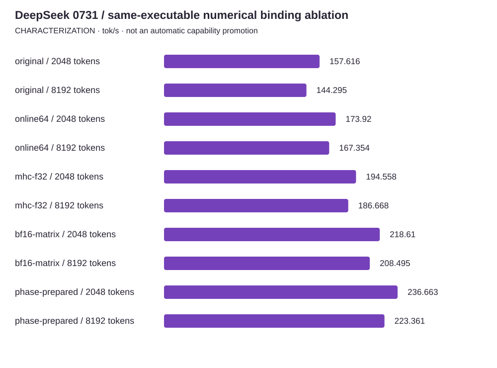

<!-- docs:metadata
title: DeepSeek 0731 / same-executable numerical binding ablation
id: yvex.evaluation.observation.deepseek-0731-binding-ablation-20261013
document: evaluation
status: current
owner: evaluation
audience: [engineer, evaluator, agent]
publication: {html: true, pdf: true, index: true}
generated: true
source: ../data/deepseek-0731-binding-ablation-20261013.json
-->

# DeepSeek 0731 / same-executable numerical binding ablation

**CHARACTERIZATION — one structured observation, with its original limits.**

[Benchmarks](../README.md) · [Source observation](../data/deepseek-0731-binding-ablation-20261013.json)

| Measurement | Value | Unit | Samples | Scope |
| --- | ---: | --- | ---: | --- |
| original / 2048 tokens | 157.61594837577013 | tok/s | 3 | Same executable; exact newly executed input; explicitly different admitted numerical bindings; no independent model-quality claim |
| original / 8192 tokens | 144.2951966402586 | tok/s | 3 | Same executable; exact newly executed input; explicitly different admitted numerical bindings; no independent model-quality claim |
| online64 / 2048 tokens | 173.92019011230929 | tok/s | 3 | Same executable; exact newly executed input; explicitly different admitted numerical bindings; no independent model-quality claim |
| online64 / 8192 tokens | 167.3537999768765 | tok/s | 3 | Same executable; exact newly executed input; explicitly different admitted numerical bindings; no independent model-quality claim |
| mhc-f32 / 2048 tokens | 194.5579036852817 | tok/s | 3 | Same executable; exact newly executed input; explicitly different admitted numerical bindings; no independent model-quality claim |
| mhc-f32 / 8192 tokens | 186.66768263834211 | tok/s | 3 | Same executable; exact newly executed input; explicitly different admitted numerical bindings; no independent model-quality claim |
| bf16-matrix / 2048 tokens | 218.61008270882982 | tok/s | 3 | Same executable; exact newly executed input; explicitly different admitted numerical bindings; no independent model-quality claim |
| bf16-matrix / 8192 tokens | 208.4950013189816 | tok/s | 3 | Same executable; exact newly executed input; explicitly different admitted numerical bindings; no independent model-quality claim |
| phase-prepared / 2048 tokens | 236.66334747400379 | tok/s | 3 | Same executable; exact newly executed input; explicitly different admitted numerical bindings; no independent model-quality claim |
| phase-prepared / 8192 tokens | 223.36140635391286 | tok/s | 3 | Same executable; exact newly executed input; explicitly different admitted numerical bindings; no independent model-quality claim |

## Context

Model: **DeepSeek-V4-Flash-0731**. Backend: **cuda**. Device: **NVIDIA DGX Spark GB10**.
Source commit: `ceeca35f5fa5b12b243cf4e61752cabfd2f15afd`. Source stability: **frozen**. Warm/cold: **warm**.

Evidence pointer: Canonical qualification receipts in runtime_configuration.arms; external source, raw events and restoration witnesses remain hash-bound there.

## Limits

- Same-build binding ablation, not equivalent-arithmetic kernel A/B.
- Each binding selects cumulative admitted numerical choices; marginal effects are conditional on earlier choices.
- No independent held-out checkpoint quality, automatic recommendation, installed rollout or 20/700 exit.
- Fresh state after a separate warmup; no prefix reuse or cache eviction. Sampled clear resource observations are not a continuous reservation.
- Complete-request native timing is uninstrumented; CUPTI diagnostics are separate records.

The [methodology](../methodology.md) defines comparability. A document import does not rerun this experiment.
