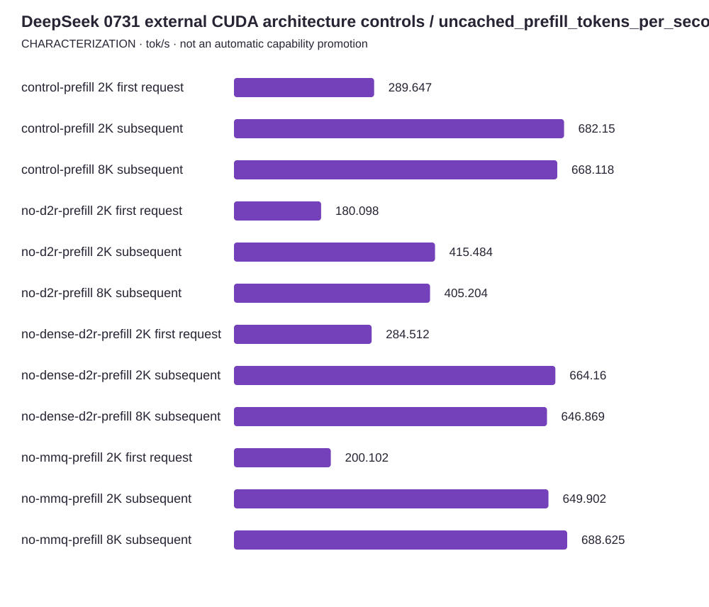

<!-- docs:metadata
title: DeepSeek 0731 external CUDA architecture controls / uncached_prefill_tokens_per_second
id: yvex.evaluation.observation.deepseek-0731-reference-architecture-20261012
document: evaluation
status: current
owner: evaluation
audience: [engineer, evaluator, agent]
publication: {html: true, pdf: true, index: true}
generated: true
source: ../data/deepseek-0731-reference-architecture-20261012.json
-->

# DeepSeek 0731 external CUDA architecture controls / uncached_prefill_tokens_per_second

**CHARACTERIZATION — one structured observation, with its original limits.**

[Benchmarks](../README.md) · [Source observation](../data/deepseek-0731-reference-architecture-20261012.json)

| Measurement | Value | Unit | Samples | Scope |
| --- | ---: | --- | ---: | --- |
| control-prefill 2K first request | 289.647111857 | tok/s | 1 | 2049 executed tokens; first post-load request includes lazy preparation |
| control-prefill 2K subsequent | 682.1503026165001 | tok/s | 2 | 2049 newly executed tokens; fresh sessions; no prefix reuse; external control only |
| control-prefill 8K subsequent | 668.118037978 | tok/s | 3 | 8203 newly executed tokens; fresh sessions; no prefix reuse; external control only |
| no-d2r-prefill 2K first request | 180.09807225 | tok/s | 1 | 2049 executed tokens; first post-load request includes lazy preparation |
| no-d2r-prefill 2K subsequent | 415.484086946 | tok/s | 2 | 2049 newly executed tokens; fresh sessions; no prefix reuse; external control only |
| no-d2r-prefill 8K subsequent | 405.203627894 | tok/s | 3 | 8203 newly executed tokens; fresh sessions; no prefix reuse; external control only |
| no-dense-d2r-prefill 2K first request | 284.51165726 | tok/s | 1 | 2049 executed tokens; first post-load request includes lazy preparation |
| no-dense-d2r-prefill 2K subsequent | 664.1603077284999 | tok/s | 2 | 2049 newly executed tokens; fresh sessions; no prefix reuse; external control only |
| no-dense-d2r-prefill 8K subsequent | 646.86927756 | tok/s | 3 | 8203 newly executed tokens; fresh sessions; no prefix reuse; external control only |
| no-mmq-prefill 2K first request | 200.102350409 | tok/s | 1 | 2049 executed tokens; first post-load request includes lazy preparation |
| no-mmq-prefill 2K subsequent | 649.9015083070001 | tok/s | 2 | 2049 newly executed tokens; fresh sessions; no prefix reuse; external control only |
| no-mmq-prefill 8K subsequent | 688.6248054 | tok/s | 3 | 8203 newly executed tokens; fresh sessions; no prefix reuse; external control only |

## Context

Model: **DwarfStar DeepSeek V4 Flash 0731 release**. Backend: **external CUDA, pinned objects and standalone public C consumers**. Device: **one NVIDIA GB10; GPU-7659fe74-b7c2-6e3e-bf99-f66c430366bc; driver 580.159.03**.
Source commit: `9139e2ae58a41503968a500f36f75895c1ba63fc`. Source stability: **frozen**. Warm/cold: **mixed**.

Evidence pointer: /home/dgmothx/lab/models/evidence/program-p-convergence-20261012.VxnrFZDv/reference-architecture-ablation-02; each raw/identity/resource receipt is hash-bound in runtime_configuration

## Limits

- External ablations are not same-artifact YVEX comparisons or independent model-quality qualification.
- DS4_CUDA_MMQ=0 changes the prefill tier; routed expert D2R remains active. It is not all-MMQ disabled.
- First request is separate; two subsequent 2K/coding samples are not three steady samples.
- Alternative reference reductions may differ numerically; throughput comparison does not certify equivalence.
- No cache eviction. File warming and lazy execution preparation are distinct.
- Source-level Entrpi and latest antirez inspection does not reproduce their self-reported benchmark numbers.

The [methodology](../methodology.md) defines comparability. A document import does not rerun this experiment.
